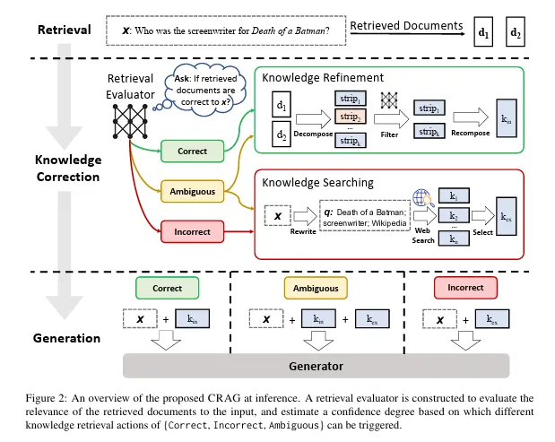
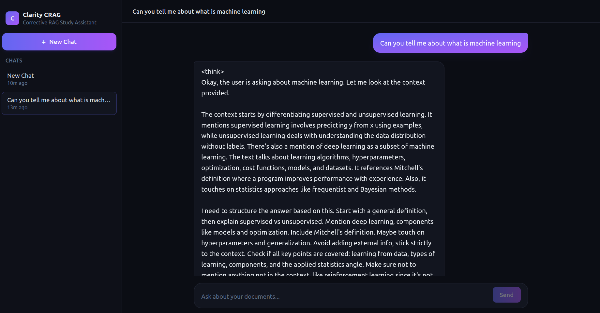
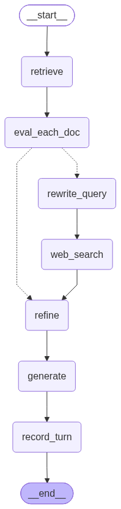

# Clarity CRAG

Clarity CRAG is a chat application built around **Corrective Retrieval-Augmented
Generation (CRAG)**. It does not blindly pass retrieved documents to a language
model. Instead, it checks whether the retrieved information is useful, searches
the web when the local knowledge base is not enough, and filters the final
context before generating an answer.

The project combines a FastAPI and LangGraph backend with a React chat interface.
It was created by **Meet Jain** as a practical way to understand how retrieval,
evaluation, web search, and answer generation fit together in a real RAG system.

## Why I created this project

I wanted to go beyond a basic RAG demo.

A typical RAG pipeline retrieves the nearest document chunks and assumes they
are relevant. That works when the knowledge base is a good match for the
question, but it can produce weak or unsupported answers when retrieval is
incomplete, noisy, or simply wrong. The model may still sound confident even
when its context is not useful.

Clarity CRAG was built to explore a more careful approach:

1. Retrieve possible evidence from a document collection.
2. Grade each retrieved chunk for relevance.
3. Decide whether the local evidence is **correct**, **incorrect**, or
   **ambiguous**.
4. Use web search when the local evidence needs help.
5. Keep only the most relevant sentences.
6. Generate an answer from the filtered evidence.

The goal is not to make the model appear more confident. The goal is to make
the path from a question to an answer easier to inspect and trust.

## What I learned

This project started as a sequence of small experiments in
[`iterative_notebooks/`](iterative_notebooks/). Each notebook added one idea:
basic retrieval, sentence-level refinement, retrieval grading, web fallback,
query rewriting, and finally three-way routing.

Moving those experiments into an application taught me several practical
lessons:

- Retrieval quality matters as much as model quality.
- A single similarity score is not enough to decide whether context is useful.
- Sentence-level filtering can remove distracting details before generation.
- Fallbacks are important because providers, rate limits, and structured output
  can all fail in production.
- Persistent conversation state is a separate concern from thread metadata.
- Evaluation should compare the corrective pipeline with a simpler baseline,
  rather than relying only on examples that look good.

## How CRAG works here



The application follows this flow:

```text
User question
      |
      v
Retrieve document chunks from Pinecone
      |
      v
Grade every chunk with an LLM
      |
      +--> CORRECT    --> refine local context
      |
      +--> INCORRECT  --> rewrite query --> Tavily web search
      |
      +--> AMBIGUOUS  --> rewrite query --> combine local and web context
                                                |
                                                v
                                  split into sentence-level strips
                                                |
                                                v
                                  keep only relevant strips
                                                |
                                                v
                                  answer from filtered evidence
```

The verdict thresholds are configurable. A response also tells the interface
whether web search was used, so the correction decision is visible rather than
hidden inside the pipeline.

## Screenshots and diagrams

### Chat dashboard



The interface provides separate chat threads, message history, verdict badges,
and a clear indication when an answer used web search.

### LangGraph workflow



This diagram is generated from the graph definition with
[`backend/scripts/save_graph_image.py`](backend/scripts/save_graph_image.py).

## Architecture

The main pieces are:

- **React, Vite, and Tailwind CSS** provide the chat UI.
- **FastAPI** exposes the HTTP API.
- **LangGraph** coordinates retrieval, grading, routing, refinement, and
  generation.
- **Pinecone** stores document embeddings and handles similarity search.
- **SQLite** stores LangGraph checkpoints for short-term conversation memory
  and stores thread metadata for the sidebar.
- **Tavily** supplies live web results when the local evidence is not reliable.
- **LangSmith** can trace graph nodes and model calls when enabled.

The chat model chain currently tries Groq first, then Gemini, and then three
Hugging Face-hosted open models as fallbacks. Embeddings use Gemini with a local
FastEmbed fallback. Both embedding providers must use the same vector
dimension; the default is 512.

## Project structure

```text
Clarity CRAG/
├── assets/
│   ├── CRAG.png
│   ├── Dashboard_CRAG.png
│   └── graph.png
├── documents/                  # PDFs used as the local knowledge base
├── iterative_notebooks/        # Research progression from basic RAG to CRAG
├── backend/
│   ├── app/
│   │   ├── crag/               # State, prompts, nodes, graph, and vector store
│   │   ├── db.py               # Thread metadata store
│   │   ├── main.py             # FastAPI application
│   │   └── schemas.py          # API request and response models
│   ├── scripts/
│   │   ├── ingest.py           # Embed PDFs into Pinecone
│   │   └── save_graph_image.py # Regenerate the workflow diagram
│   ├── .env.example
│   └── requirements.txt
├── frontend/
│   ├── src/
│   └── package.json
└── evaluation/
    ├── golden_dataset.json
    └── run_eval.py
```

## Tech stack

| Area | Technology |
| --- | --- |
| Backend | Python, FastAPI, Uvicorn |
| Agent workflow | LangGraph |
| Chat models | Hugging Face, Gemini, Groq fallbacks |
| Embeddings | Gemini `gemini-embedding-001` and FastEmbed |
| Vector database | Pinecone |
| Web search | Tavily |
| Memory | LangGraph `SqliteSaver` and SQLite |
| Frontend | React 19, Vite, Tailwind CSS v4 |
| Observability | LangSmith |
| Evaluation | ragas |

## Getting started

### Prerequisites

- Python 3.10 or newer
- Node.js and npm
- API keys for the providers you plan to use
- A Pinecone index configured for the embedding dimension

### 1. Configure the backend

From the repository root:

```bash
cd backend
python -m venv ../.venv
```

Activate the environment:

```bash
# macOS/Linux
source ../.venv/bin/activate

# Windows PowerShell
..\.venv\Scripts\Activate.ps1
```

Install dependencies and create the environment file:

```bash
pip install -r requirements.txt
cp .env.example .env
```

On Windows, copy the file with:

```powershell
Copy-Item .env.example .env
```

Add the required values to `backend/.env`. The commonly used keys are:

```text
HF_TOKEN=
GEMINI_API_KEY=
GROQ_API_KEY=
PINECONE_API_KEY=
TAVILY_API_KEY=
```

Optional LangSmith tracing uses `LANGCHAIN_TRACING_V2`,
`LANGCHAIN_API_KEY`, and `LANGCHAIN_PROJECT`.

### 2. Index documents

Place PDF files in `documents/`, then run:

```bash
python scripts/ingest.py
```

If you change the embedding model or `EMBEDDING_DIMENSION`, recreate the
Pinecone index before running ingestion again. The default dimension is 512.

### 3. Start the API

```bash
uvicorn app.main:app --reload --port 8000
```

The API is available at `http://localhost:8000`, with interactive
documentation at `http://localhost:8000/docs`.

### 4. Start the frontend

In a second terminal:

```bash
cd frontend
npm install
npm run dev
```

Open `http://localhost:5173`. The Vite development server proxies `/api`
requests to the FastAPI backend.

To regenerate the workflow illustration:

```bash
cd backend
python scripts/save_graph_image.py
```

## API endpoints

| Method | Endpoint | Purpose |
| --- | --- | --- |
| `GET` | `/api/health` | Check that the API is running |
| `POST` | `/api/threads` | Create a chat thread |
| `GET` | `/api/threads` | List threads |
| `DELETE` | `/api/threads/{thread_id}` | Delete a thread and its graph checkpoint |
| `GET` | `/api/threads/{thread_id}` | Read a thread's message history |
| `POST` | `/api/threads/{thread_id}/messages` | Send a message and receive the answer, verdict, and search metadata |

## Evaluation

[`evaluation/run_eval.py`](evaluation/run_eval.py) compares two pipelines on
the questions in [`evaluation/golden_dataset.json`](evaluation/golden_dataset.json):

- **Naive RAG** sends raw retrieved chunks to the model.
- **CRAG** grades, routes, refines, and optionally searches the web before
  generating an answer.

Run the evaluation from the repository root after configuring the backend and
populating Pinecone:

```bash
python evaluation/run_eval.py
```

Results are written to `evaluation/results/`, including comparison tables,
per-question scores, and a metrics chart. The evaluation uses faithfulness,
answer relevancy, context precision, context recall, and answer correctness.

## Development commands

```bash
# Frontend
cd frontend
npm run lint
npm run build
```

There is currently no automated backend test suite. The backend can be checked
manually through the API documentation at `/docs` and the evaluation script.

## Troubleshooting

- **Provider authentication errors:** copy `backend/.env.example` to
  `backend/.env`, add valid keys, and restart the API.
- **The frontend cannot reach the API:** confirm that Uvicorn is running on
  port 8000 and that the frontend is running on port 5173.
- **No documents are found during ingestion:** add PDF files to `documents/`.
- **Pinecone dimension mismatch:** recreate the index using the configured
  `EMBEDDING_DIMENSION`, then run ingestion again.
- **Requests are slow:** one question can trigger multiple model calls because
  the pipeline grades each retrieved chunk and filters each context strip.
- **Gemini rate limits:** the model chain can continue with Groq or Hugging
  Face models, while FastEmbed can provide local embedding fallback.

## Resume-ready project profile

Use the following facts when describing this project in a resume or portfolio:

- **Project:** Clarity CRAG — a corrective RAG chat application
- **Role:** Full-stack AI/ML developer
- **Author:** Meet Jain
- **Problem:** Basic RAG can pass irrelevant or incomplete retrieved context to
  an LLM, producing answers that sound confident without strong evidence.
- **Solution:** Built a retrieval-evaluation and correction pipeline that grades
  every retrieved chunk, routes evidence through three verdicts
  (CORRECT/INCORRECT/AMBIGUOUS), uses query-rewritten Tavily search when needed,
  filters context sentence by sentence, and generates from the retained strips.
- **Backend:** FastAPI, LangGraph, LangChain, Pinecone, SQLite, Tavily,
  LangSmith, and configurable multi-provider LLM fallbacks.
- **Frontend:** React 19, Vite, and Tailwind CSS v4 with chat threads,
  message history, verdict badges, web-search indicators, and thread deletion.
- **Evaluation:** Compared naive RAG and CRAG across 13 golden ML/DL questions
  using five ragas metrics: faithfulness, answer relevancy, context precision,
  context recall, and answer correctness.
- **Research progression:** Converted six iterative notebooks from a basic RAG
  prototype into a persistent full-stack application.
- **Reliability details:** Added provider fallbacks, structured-output retries,
  persistent SQLite checkpoints, configurable retrieval thresholds, and a
  local embedding fallback using FastEmbed.
- **Verified impact claims:** Report the actual metric improvements from
  `evaluation/results/comparison_table.csv` after running the evaluation. Do
  not claim accuracy or latency improvements without those generated results.

## Author

Built and maintained by **Meet Jain**.

This project is a learning-focused implementation inspired by the CRAG paper:
[Corrective Retrieval Augmented Generation](https://arxiv.org/abs/2401.15884).
